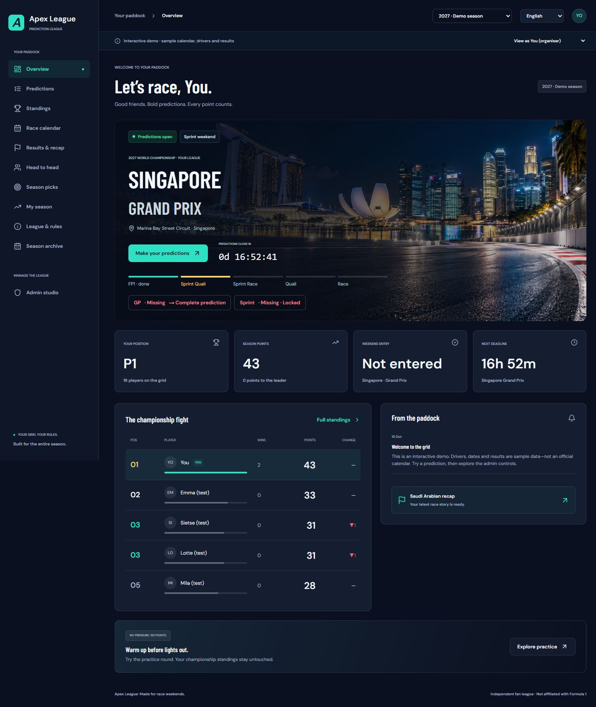
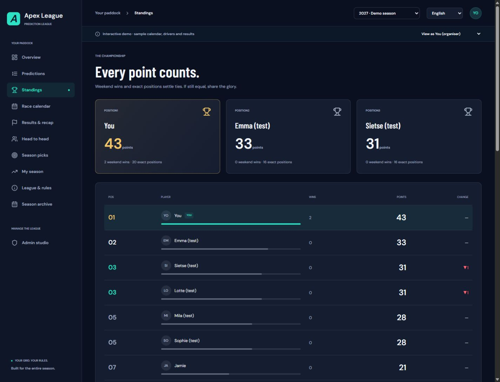
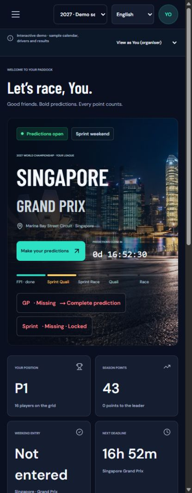
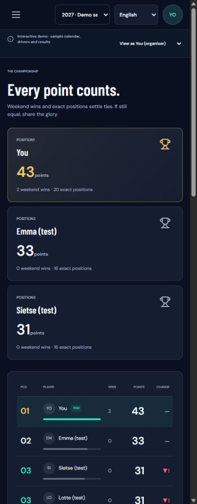

# Apex League

A self-hosted F1 prediction league for friends, with English/Dutch UI, GP and Sprint predictions, automatic scoring, banners, encrypted backups and admin tools.

- [Install, update and recover](app/DEPLOYMENT.md)
- [Changelog](CHANGELOG.md)
- [Development and release workflow](app/README.md)
- [Current release notes](app/RELEASE_NOTES.md)

Current Docker image: `ghcr.io/sietsevdm/apex-league:0.8.27`.

The admin panel reports updates. Install a release by changing APEX_IMAGE in the existing Portainer stack and re-pulling/redeploying, following the deployment guide. Persistent volumes retain the league's accounts and data.

## Screenshots

Apex League on desktop and mobile. Captured from version 0.8.17 with demo accounts and a sample calendar; dates, predictions and scores are illustrative.

### Desktop

**Overview** — race banner, live prediction countdown, session progress and league standings.

View desktop standings

### Mobile

| Overview | Standings |
| --- | --- |
|  |  |

Select a mobile screenshot to view it at full size.
